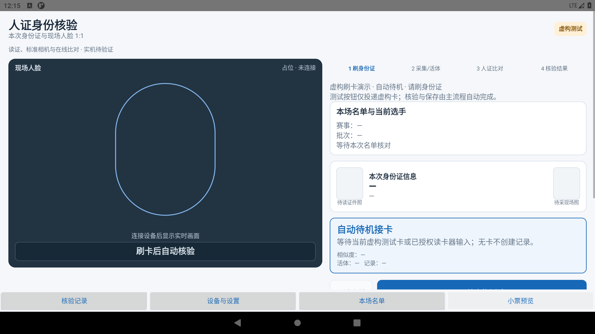
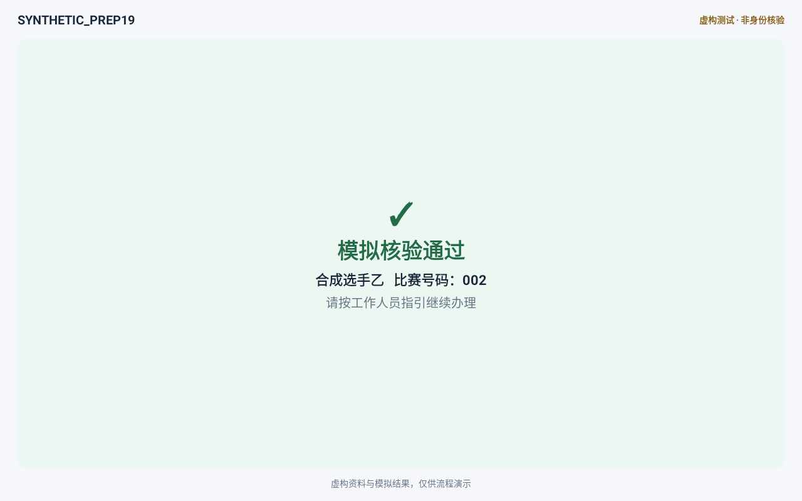
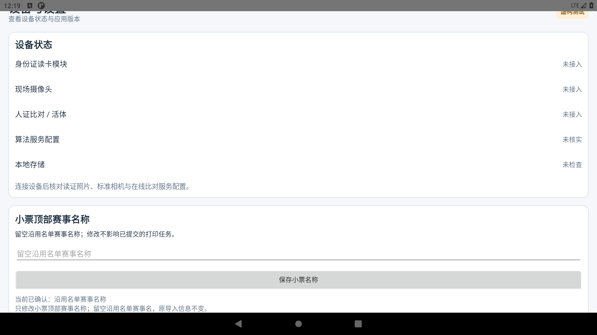
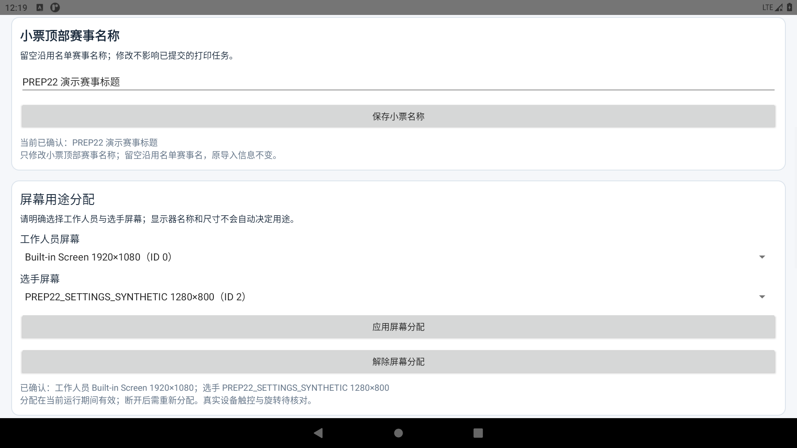
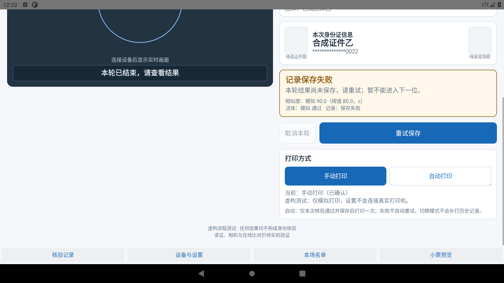

# 铁人三项身份核验 · Android 演示

当前 `main` 源码已更新至 **PREP27-FOLLOWUP（2026-10-12）**，通过定向软件及 Android 模拟器范围验收。

**下方 Release/APK 和截图仍为 PREP22（2026-10-11），不是当前源码构建产物。** 本次只更新代码，没有发布新 Release 或 APK。需要最新功能请按下方说明自行构建 TEST。

**[下载旧 PREP22 TEST APK](https://github.com/xiaojinyingzai-web/triathlon-verification-demo/releases/download/prep22-demo/triathlon-verification-demo-prep22.apk)** · [旧 PREP22 版本说明](https://github.com/xiaojinyingzai-web/triathlon-verification-demo/releases/tag/prep22-demo)

功能包括本场 Excel 名单导入与匹配、接卡后自动完成核验/保存、同卡去重和工作人员显式重核、工作人员/选手双屏角色分配、小票预览与手动/自动模拟打印、可保存的小票顶部赛事名称。

TEST 不会读取真实身份证、拍摄真实人脸、调用在线算法或连接打印机。通过和评分均为合成结果，不能用于现场身份核验。新源码的语音使用系统 TTS，需要设备有可用引擎；目前未证明中文实际声音。真实读卡器、摄像头、联网服务、纸张与两台设备逐机兼容性尚未验证。

相对旧 PREP22 新增或修复：

- 自定义语音播报：五场景文案、开关、音量、保存和试听；缺引擎不阻塞核验。
- 打印总开关：默认开启、持久化；OFF 阻止自动、手动、补打和重试的新提交，保留原模式及核验保存，重新开启不自动补印旧结果。已交设备的任务不承诺撤回或断电。
- 工作人员窗口换实例或附着后补发当前模型，避免控件停在初始化；已确认布局保持。
- 保存终态可进入名单管理，初始化退出资源清理、显式补打授权和 LIVE 网络请求主动取消。

## 旧 PREP22 APK 安装和演示

1. 在 Android 8.0 或更高版本的测试设备/模拟器下载 APK，允许当前下载应用安装，然后打开“CEFK 虚构测试 · 非身份核验”。已实际验证的环境为 Android 11/API 30 模拟器。建议横屏，工作人员目标 1920×1080，选手目标 1280×800。
2. 全新安装没有预置名单或核验记录。用 Excel 创建 `.xlsx` 或 `.xls`，第一行采用下表列名；**身份证号与比赛号码设为文本格式**，填入这两行虚构资料，保存到测试设备。

   | 身份证号 | 比赛号码 | 姓名 | 组别 | 团队 |
   | --- | --- | --- | --- | --- |
   | 990101200001010014 | 001 | 合成选手甲 | 演示组 | 演示团队 |
   | 990101200001010022 | 002 | 合成选手乙 | 演示组 | 演示团队 |

3. 进入“本场名单”，输入赛事名称“合成演示赛事”，选择文件，校验通过后确认导入，再返回核验页。请勿导入真实名单、证件号码或照片。
4. 点击“开始虚构测试”（必要时向下滚动）。按钮只投递一张合成卡，之后匹配、模拟比对和保存自动完成。再次点击投递另一张卡，无需先按“下一位”。TEST 输入甲/乙交替，系统也会保留结果和显示当前状态。
5. 通过并保存后打开“小票预览”，可模拟打印。在核验页下方可选择手动或自动打印；自动仅处理当前新结果，不追印历史。进入“设备与设置”修改“小票顶部赛事名称”，留空恢复名单赛事名。
6. 两个可用 Android 显示器时，在设置中明确选择工作人员和选手的不同显示 ID，再应用。单屏不会凭尺寸自动分配；断开/重建后需重新选择。普通单屏手机可查看工作人员页，选手页见下面截图。双屏图来自实际 Android 虚拟显示，未证明物理双屏兼容。

重启不会清除名单、记录、名称或打印模式；上一张相同卡的自动受理围栏也会保留。同卡需要工作人员明确点击“重核当前证件”后再投卡。实际保存失败时应保留本轮并重试，不能跳过。

以下仅为旧 PREP22 下载资产的身份，不是当前源码的 APK 哈希。

APK 包名：`com.triathlon.prep.simulation`；大小：**3,623,228 字节**；SHA256：

```text
B27DE53D9A0C568A825E26485AC3AB3FE9726ECA705B4E4DC7BA1118D48FD123
```

## 界面预览

以下保留的是 **PREP22 历史合成 TEST 画面**，无真实人员/证件照片；不展示新增语音或总开关，也不证明当前源码的新运行结果。设置截图按对应区域滚动采集。

工作人员待机：实际 TEST Host，无卡不会创建记录。



选手结果：实际 TEST Host 当前合成结果，Android Presentation，1280×800。



小票顶部名称：留空沿用名单赛事名；正常 Android 偏好保存。



双屏角色：实际 Android 虚拟显示和明确选择，非物理双屏。



保存恢复：外部测试夹具注入保存异常后的实际 Host 提示，不代表已验证真实磁盘故障。此夹具未包含在下载 APK 中。



## 源码和构建

自有源码在 [`android/`](android/)，包括核心流程、名单/记录存储、原生 UI、自动接卡与显示控制，以及我们编写的 LIVE 适配层。源码来自已验收 PREP27-FOLLOWUP 固定候选的自有文件白名单；应用 Java/XML 和核心测试保持原字节。仅 `app/build.gradle` 保留公开分发保护：缺少另行取得的厂家 AAR 时，LIVE 构建明确报错；不修改业务逻辑。

准备 **JDK 17、Gradle 8.11.1、Android SDK Platform 35 / Build Tools 35.0.0**。将项目放在无中文/空格的路径，Android Studio 打开 `android/` 并配置自己的 SDK，或通过 `ANDROID_HOME` 设置 SDK。联网首次解析 Google/Maven Central 的依赖后执行：

```shell
cd android
gradle :app:assembleSimulationDebug
```

输出 `app/build/outputs/apk/simulation/debug/app-simulation-debug.apk`。本仓库不包含 Gradle Wrapper 二进制、JDK、SDK 或公共依赖缓存；使用已安装的 Gradle。本地重建使用自己的 debug 签名，生成的是当前源码版本；上面的 PREP22 下载包仍为历史产物，二者版本与 APK 哈希不同。

最新 TEST 运行：先按上面的合成名单准备方法导入虚构数据，再在打印方式区域切换总开关及手动/自动模式；“设备与设置”中可保存语音开关、音量和五场景文案并试听。OFF 不影响核验、保存与预览，重新开启只恢复后续权限，不追印旧结果。语音实际合成与设备输出仍需现场验证。

核心检查可独立运行：

```shell
gradle -PcoreOnly :core:check
```

LIVE 默认配置为 `null`，没有 INTERNET 权限，不能直接启用。厂家 SDK/AAR、密钥和凭据不在仓库；要构建 LIVE，必须自行取得合法的厂家依赖并放入 `app/src/live/libs/cefk/`，再按授权验证设备、服务和打印配置。单独编译并不等于可以投入赛事。

开源依赖的随包许可证/声明见 [`THIRD_PARTY_NOTICES.md`](THIRD_PARTY_NOTICES.md) 与 [`third-party/`](third-party/)。这些许可证适用于对应依赖，不自动为本项目自有源码授予同样许可证。

## 验证边界

当前验收覆盖软件门禁、配置持久化、资源/会话隔离及 Android 合成显示的定向运行。副屏恢复用受控渲染时序取得旧红新绿；旧两次补拍没有完整时序，不能追认各自唯一根因。真实 USB 读证、相机、在线人脸服务、物理双屏/触控、中文 TTS、打印出纸和两台实机兼容性待逐机联调。系统文件选择器取消与完整 Android 导入路径的既有验证缺口仍保留；模拟通过不代表赛事身份核验通过。
